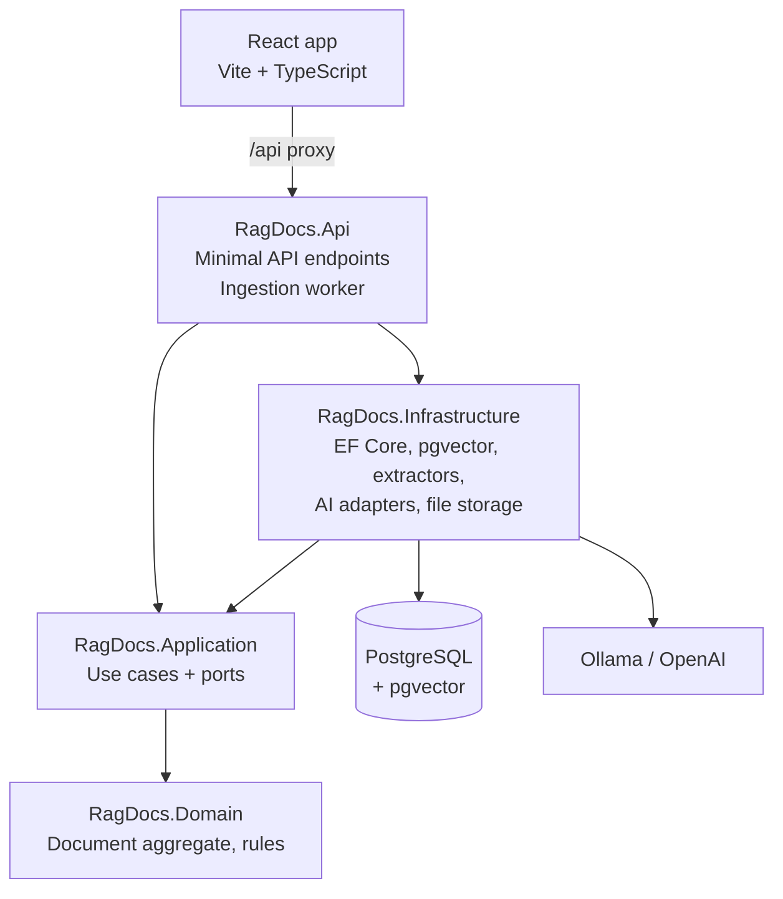

# RagDocs

**Chat with your documents.** RagDocs is a Retrieval-Augmented Generation (RAG) app built with .NET 10. Upload PDFs, Word files or text, then ask questions in plain English and get answers grounded in your documents — with citations back to the exact file and page.

> 🚧 **Work in progress.** This project is being built step by step. 

---

## Features

- **Upload documents** — PDF, DOCX, TXT and Markdown, with duplicate detection by content hash
- **Background ingestion** — text extraction, structure-aware chunking with overlap, and batched embeddings
- **Semantic search** — PostgreSQL + pgvector with an HNSW index
- **Hybrid search** — vector similarity and full-text keyword search fused with Reciprocal Rank Fusion
- **Grounded, cited answers** — streamed token by token, citing sources as `[1]`, `[2]`, and saying so when the documents don't contain the answer
- **Conversations** — follow-up questions are rewritten into standalone queries before searching
- **Retrieval evaluation** — a golden question set measuring recall@5 and MRR, so changes are backed by numbers
- **Secure by design** — per-user isolation with Postgres row-level security, prompt-injection defences, rate limiting
- **Local-first AI** — runs fully offline with Ollama, or with OpenAI via configuration

---

## Architecture

The backend follows **Clean Architecture** with **minimal APIs**. Dependencies point inwards: the Domain knows nothing about databases, HTTP or AI providers.



| Layer | Responsibility | Depends on |
|---|---|---|
| **Domain** | Entities and business rules (e.g. a document's status lifecycle) | nothing |
| **Application** | Use cases and the interfaces (ports) they need | Domain |
| **Infrastructure** | Implements the ports: EF Core, pgvector, PdfPig, Microsoft.Extensions.AI, storage | Application |
| **Api** | Thin host: dependency injection, endpoints, background worker | Application, Infrastructure |

### How a question is answered

```
INGESTION   upload → extract text → chunk (with overlap) → embed → store in pgvector
QUERY       question → rewrite (if follow-up) → embed → hybrid search → prompt with sources → streamed answer + citations
```

---

## Tech stack

| Area | Technology |
|---|---|
| Backend | .NET 10, ASP.NET Core minimal APIs |
| Orchestration | .NET Aspire (local dev, dashboard, telemetry) |
| Database | PostgreSQL 17 + pgvector (HNSW index), EF Core |
| AI | Microsoft.Extensions.AI with Ollama (local) or OpenAI |
| Document parsing | PdfPig, DocumentFormat.OpenXml |
| Frontend | React, TypeScript, Vite, TanStack Query |
| Testing | xUnit, Testcontainers, NetArchTest |

---

## Project structure

```
RagDocs/
├── src/
│   ├── RagDocs.Domain/            # Entities, Result/Error, business rules
│   ├── RagDocs.Application/       # Use cases and ports
│   ├── RagDocs.Infrastructure/    # EF Core, pgvector, extractors, AI adapters
│   ├── RagDocs.Api/               # Minimal API + ingestion worker
│   ├── RagDocs.AppHost/           # Aspire orchestration
│   ├── RagDocs.ServiceDefaults/   # Telemetry, health checks, resilience
│   └── ragdocs-web/               # React frontend
└── tests/
    ├── RagDocs.UnitTests/         # Domain, Application, architecture rules
    └── RagDocs.IntegrationTests/  # Postgres via Testcontainers, API, retrieval evaluation
```

---

## Getting started

### Prerequisites

- [.NET 10 SDK](https://dotnet.microsoft.com/download)
- [Docker Desktop](https://www.docker.com/products/docker-desktop/) (running)
- [Node.js LTS](https://nodejs.org/) (for the React app)
- Aspire templates: `dotnet new install Aspire.ProjectTemplates`

### 1. Clone and trust the dev certificate

```bash
git clone <your-repo-url>
cd RagDocs
dotnet dev-certs https --trust
```

### 2. Set the local database password

```bash
dotnet user-secrets set "Parameters:postgres-password" "<choose-a-password>" --project src/RagDocs.AppHost
```

Secrets are stored in your user profile, never in the repository.

### 3. Run

```bash
dotnet run --project src/RagDocs.AppHost
```

Open the **Aspire dashboard** link printed in the console. It starts PostgreSQL (with pgvector), pgAdmin, the API and the web app, and shows their logs, traces and health.

> The first run downloads container images and AI models, so it takes a few minutes.

---

## Running the tests

```bash
dotnet test
```

Integration tests start a real PostgreSQL + pgvector container with Testcontainers, so Docker must be running. Retrieval-evaluation tests use a real embedding model and are tagged so they can be skipped in fast runs.

---

## Design decisions

- **One database for everything.** pgvector keeps documents, chunks, embeddings and full-text search in PostgreSQL — no separate vector database to run.
- **HNSW index** instead of IVFFlat: good recall and it can be built on an empty table.
- **Hybrid search with Reciprocal Rank Fusion.** Vector search handles meaning; keyword search catches exact terms like part numbers and names. RRF merges by rank, so no score-scale tuning is needed.
- **Postgres as a job queue.** `FOR UPDATE SKIP LOCKED` lets workers claim documents safely without a message broker.
- **Result pattern** for expected failures, exceptions only for the unexpected.
- **Rich domain model.** A document's status can only change through methods that enforce valid transitions.
- **Provider-agnostic AI.** Application code depends on its own ports; switching between Ollama and OpenAI is configuration only.
- **Measured, not guessed.** Retrieval changes are evaluated against a golden question set (recall@5, MRR).

---

## Roadmap

- [x] Solution, Aspire AppHost, PostgreSQL + pgvector
- [ ] Domain model and unit tests
- [ ] Upload use case, persistence and document endpoints
- [ ] Text extraction and chunking
- [ ] Embeddings and vector storage
- [ ] Background ingestion worker
- [ ] Semantic search and streamed, cited answers
- [ ] Delete and edge cases
- [ ] Integration tests and retrieval evaluation
- [ ] Hybrid search (vector + keyword, RRF)
- [ ] React UI: documents and chat
- [ ] Conversations: chat history and query rewriting
- [ ] Authentication, row-level security, rate limiting, prompt-injection tests

**Later:** separate ingestion service, re-ranking, saved conversations, real-time progress with SignalR, Azure deployment.

---

## Evaluation results

*Coming once the golden set is in place.*

| Retrieval | Recall@5 | MRR |
|---|---|---|
| Vector only | – | – |
| Hybrid (RRF) | – | – |

---


## Author

**Maria Peter** — Senior .NET & Full-Stack Developer
