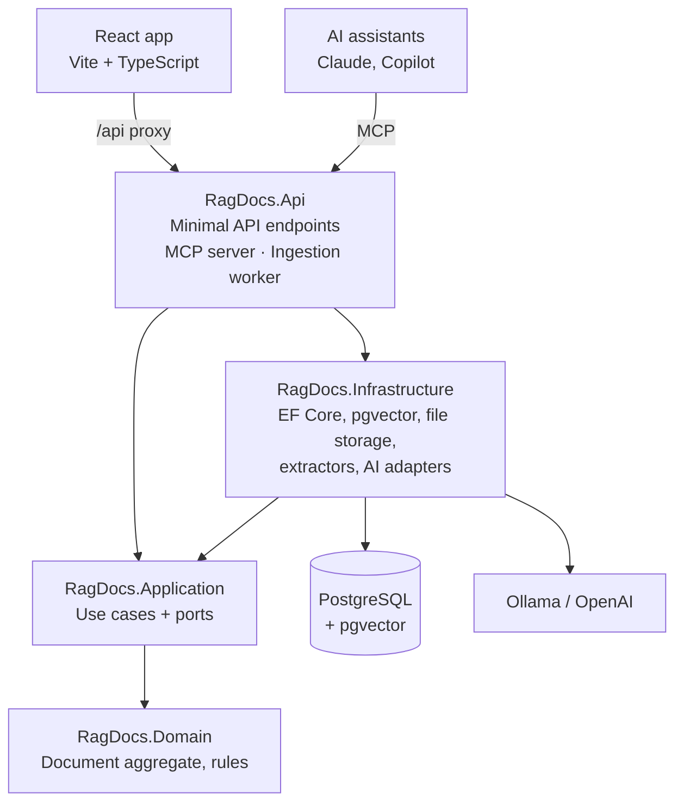

# RagDocs

**Chat with your documents.** RagDocs is a Retrieval-Augmented Generation (RAG) app built with .NET 10. Upload PDFs, Word files or text, ask questions in plain English, and get answers grounded in your documents — with citations back to the exact file and page. Your documents can also be searched by AI assistants through a built-in **MCP server**.

> 🚧 **Work in progress.** Built step by step in 2-hour sessions. See the [Roadmap](#roadmap) for what's done and what's next.

---

## Features

**Working now**
- **Upload documents** — PDF, DOCX, TXT and Markdown, up to 20 MB
- **Real file-type detection** from the file's bytes (a renamed `.exe` can't pass as a PDF)
- **Duplicate detection** by SHA-256 content hash, per user
- **Consistent errors** — every failure is ProblemDetails JSON with a stable `code` and a `traceId`
- **Architecture tests** that fail the build if the layers depend on the wrong things

**Coming next**
- **Background ingestion** — text extraction, structure-aware chunking with overlap, batched embeddings
- **Semantic search** with PostgreSQL + pgvector (HNSW index)
- **Hybrid search** — vector + full-text keyword search fused with Reciprocal Rank Fusion
- **Grounded, cited answers** streamed token by token, with an explicit "I don't have information" path
- **MCP server** — `search_documents` and `list_documents` tools for Claude, VS Code / Copilot and other MCP clients
- **React UI** with streaming chat and follow-up questions (query rewriting)
- **Retrieval evaluation** — a golden question set measuring recall@5 and MRR
- **Security** — per-user isolation with Postgres row-level security, prompt-injection tests, rate limiting
- **Local-first AI** — runs fully offline with Ollama, or with OpenAI via configuration

---

## Architecture

**Clean Architecture** with **minimal APIs**. Dependencies point inwards; the Domain knows nothing about databases, HTTP or AI providers.



| Layer | Responsibility | Depends on |
|---|---|---|
| **Domain** | Entities and business rules (e.g. a document's status lifecycle) | nothing |
| **Application** | Use cases and the interfaces (ports) they need | Domain |
| **Infrastructure** | Implements the ports: EF Core, pgvector, file storage, PdfPig, Microsoft.Extensions.AI | Application |
| **Api** | Thin host: DI wiring, endpoints, MCP server, background worker | Application, Infrastructure |

### How a question is answered

```
INGESTION   upload → detect type → hash → store → extract text → chunk (with overlap) → embed → pgvector
QUERY       question → rewrite (if follow-up) → embed → hybrid search → prompt with sources → streamed answer + citations
```

---

## Tech stack

| Area | Technology |
|---|---|
| Backend | .NET 10, ASP.NET Core minimal APIs |
| Orchestration | .NET Aspire (local dev, dashboard, OpenTelemetry) |
| Database | PostgreSQL 17 + pgvector, EF Core 10 (Npgsql), snake_case naming |
| AI | Microsoft.Extensions.AI with Ollama (local) or OpenAI |
| Document parsing | PdfPig, DocumentFormat.OpenXml |
| MCP | ModelContextProtocol.AspNetCore |
| Frontend | React, TypeScript, Vite, TanStack Query |
| Testing | xUnit, in-memory fakes, NetArchTest, Testcontainers |

---

## Project structure

```
RagDocs/
├── src/
│   ├── RagDocs.Domain/            # Entities, Result/Error, business rules
│   ├── RagDocs.Application/       # Use cases and ports
│   ├── RagDocs.Infrastructure/    # EF Core, pgvector, file storage, extractors, AI adapters
│   │   └── Migrations/            # EF Core migrations
│   ├── RagDocs.Api/               # Minimal API, MCP server, ingestion worker
│   ├── RagDocs.AppHost/           # Aspire orchestration
│   ├── RagDocs.ServiceDefaults/   # Telemetry, health checks, resilience
│   └── ragdocs-web/               # React frontend
├── tests/
│   ├── RagDocs.UnitTests/         # Domain, Application, architecture rules
│   └── RagDocs.IntegrationTests/  # Postgres via Testcontainers, API, retrieval evaluation
├── plan.md                        # Full build plan
├── schedule.md                    # Session schedule and progress
├── NOTES.md                       # Session log, test catch-up list, decisions
└── CLAUDE.md                      # Conventions for AI coding assistants
```

---

## Getting started

### Prerequisites

- [.NET 10 SDK](https://dotnet.microsoft.com/download)
- [Docker Desktop](https://www.docker.com/products/docker-desktop/) (running)
- [Node.js LTS](https://nodejs.org/) (for the React app, later)
- Aspire templates: `dotnet new install Aspire.ProjectTemplates`
- EF Core tools (for migrations): `dotnet tool install --global dotnet-ef`

### 1. Clone and trust the dev certificate

```bash
git clone https://github.com/<your-username>/RagDocs.git
cd RagDocs
dotnet dev-certs https --trust
```

### 2. Set the local database password

```bash
dotnet user-secrets set "Parameters:postgres-password" "<choose-a-password>" --project src/RagDocs.AppHost
```

Secrets are stored in your user profile, never in the repository. Choose it once — the database volume keeps the first password.

### 3. Run

```bash
dotnet run --project src/RagDocs.AppHost
```

Open the **Aspire dashboard** link printed in the console. It starts PostgreSQL (with pgvector), pgAdmin and the API, applies database migrations automatically in Development, and shows logs, traces and health.

> Always start the **AppHost** — the API gets its database connection string from Aspire.
> The first run downloads container images, so it takes a few minutes.

### 4. Try the API

Open `src/RagDocs.Api/RagDocs.Api.http` in Visual Studio, Rider or VS Code (REST Client), set `@host` to the API's https address from the dashboard, and send the requests. Sample files are in `src/RagDocs.Api/TestFiles/`.

Or with curl:

```bash
curl -k -F "file=@src/RagDocs.Api/TestFiles/sample.pdf" https://localhost:7123/documents
curl -k https://localhost:7123/documents
```

---

## API

| Method | Route | Description | Responses |
|---|---|---|---|
| `POST` | `/documents` | Upload a file (`multipart/form-data`, field `file`) | **202** new (with `Location`), **200** duplicate, 400, 413 |
| `GET` | `/documents` | List my documents, newest first | 200 |
| `GET` | `/documents/{id}` | Get one document | 200, 404 |
| `POST` | `/search` | Semantic search without generation | *coming* |
| `POST` | `/ask` | Streamed, cited answer (Server-Sent Events) | *coming* |
| `DELETE` | `/documents/{id}` | Delete a document and its chunks | *coming* |
| — | `/mcp` | MCP server endpoint | *coming* |

Errors are [ProblemDetails](https://www.rfc-editor.org/rfc/rfc9457):

```json
{
  "title": "Validation error",
  "status": 400,
  "detail": "Only PDF, DOCX, TXT and Markdown files are supported.",
  "code": "Upload.UnsupportedFileType",
  "traceId": "00-4bf92f3577b34da6a3ce929d0e0e4736-00f067aa0ba902b7-01"
}
```

The OpenAPI document is served at `/openapi/v1.json` in Development.

---

## Running the tests

```bash
dotnet test
```

- **Unit tests** cover the Domain rules and the Application handlers using hand-written in-memory fakes — no database needed.
- **Architecture tests** fail if Domain or Application depend on EF Core, ASP.NET Core or Infrastructure.
- **Integration tests** (coming) start a real PostgreSQL + pgvector container with Testcontainers, so Docker must be running. Retrieval-evaluation tests are tagged so they can be skipped in fast runs.

---

## Design decisions

- **One database for everything.** pgvector keeps documents, chunks, embeddings and full-text search in PostgreSQL — no separate vector database.
- **Result pattern** for expected failures, exceptions only for the unexpected; a single mapping turns error types into HTTP status codes.
- **Rich domain model.** A document's status can only change through methods that enforce valid transitions.
- **Detect, don't trust.** File types come from magic bytes; owners come from the authenticated user, never from the request.
- **Duplicates are a success.** Uploading the same file twice returns the existing document (200) instead of an error.
- **The database enforces uniqueness.** A unique `(owner_id, content_hash)` index closes the race that code checks alone can't.
- **Same-instance unit of work.** `RagDbContext` implements `IUnitOfWork`, so handlers save through one transaction without depending on EF Core.
- **HNSW index** instead of IVFFlat: good recall and it can be built on an empty table.
- **Hybrid search with Reciprocal Rank Fusion.** Vector search handles meaning; keyword search catches exact terms like part numbers and names.
- **Postgres as a job queue.** `FOR UPDATE SKIP LOCKED` lets workers claim documents safely without a message broker.
- **Provider-agnostic AI.** Application code depends on its own ports; switching between Ollama and OpenAI is configuration only.
- **MCP reuses the use cases.** The MCP tools call the same handlers as the HTTP endpoints — no duplicated logic.
- **Measured, not guessed.** Retrieval changes are evaluated against a golden question set (recall@5, MRR).

---

## Security

- Per-user isolation: every query filters by owner; another user's document returns 404, not 403
- Postgres row-level security as a second line of defence (planned)
- Prompt-injection defences: retrieved text and MCP tool results are delimited and treated as data, with injection documents in the test set (planned)
- Path-traversal protection in file storage; upload size limits enforced before the request is read
- No secrets in the repository: user secrets locally, Aspire-provided connection strings at runtime
- No document text or full prompts in production logs

---

## Roadmap

- [x] Solution, Aspire AppHost, PostgreSQL + pgvector
- [x] Domain model and unit tests
- [x] Application layer: upload, get and list use cases with in-memory fake tests
- [x] Persistence: EF Core, snake_case schema, indexes, migrations
- [x] Document endpoints, file storage, ProblemDetails, architecture tests
- [ ] Text extraction and chunking
- [ ] Embeddings and vector storage
- [ ] Background ingestion worker
- [ ] Semantic search and streamed, cited answers
- [ ] MCP server
- [ ] React UI: documents and streaming chat
- [ ] Integration tests and retrieval evaluation
- [ ] Hybrid search (vector + keyword, RRF)
- [ ] Conversations: chat history and query rewriting
- [ ] Authentication, row-level security, rate limiting, prompt-injection tests

**Later:** separate ingestion service, re-ranking, saved conversations, real-time progress with SignalR, Azure deployment.

---

## Evaluation results

*Coming once the golden set is in place.*

| Retrieval | Recall@5 | MRR |
|---|---|---|
| Vector only | – | – |
| Hybrid (RRF) | – | – |

---

## References

- Milan Jovanović — [Building a RAG System in .NET](https://milanjovanovic.tech/blog/rag-system-dotnet)
- [pgvector](https://github.com/pgvector/pgvector)
- [.NET Aspire](https://aspire.dev)
- [Microsoft.Extensions.AI](https://learn.microsoft.com/dotnet/ai/microsoft-extensions-ai)
- [Model Context Protocol](https://modelcontextprotocol.io)

---

## Author

**Maria Peter** — Senior .NET & Full-Stack Developer
